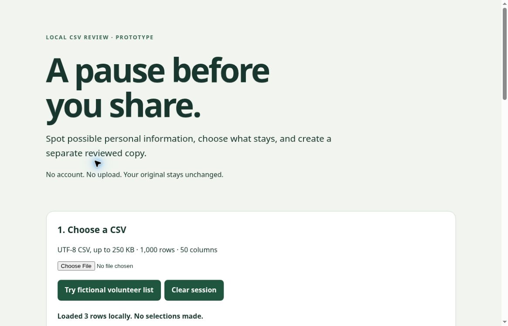

# ShareCheck 0.1.0

A deliberate review step before sharing a CSV. ShareCheck highlights a small set of potentially sensitive column names and email/number patterns, lets a person choose entire columns to omit, and exports a separate reviewed copy plus a minimal decision record.

## Run

Open `index.html` in a modern browser. A secure context providing Web Crypto is required (modern file URLs, localhost or HTTPS). If direct-file execution is restricted by your browser, serve this folder with a local static server, for example `python3 -m http.server 8000`, then visit `http://localhost:8000`. No build, account, API key, dependency or paid service is required by the app. Node is needed only for unit tests.

## Workflow

1. Try the fictional volunteer list, or select UTF-8 comma-separated CSV.
2. Review *every* column, not only flagged columns. The example intentionally includes a person-like volunteer field that the simple header detector does not recognize.
3. Check columns to omit; uncheck or use Undo to restore them. The preview shows the first eight data rows. No columns are preselected.
4. Confirm the review. Download a reviewed CSV and an optional JSON decision record. Changing selection invalidates confirmation.
5. Inspect the receiving application before sharing. Downloading the original explicitly provides unsanitized, unchanged bytes.
6. Clear the session when finished. No localStorage, database, telemetry, external library, upload or network API is used by app code.

## Deliberately narrow scope

This is not a PII scanner, anonymizer, compliance assessor, DLP system or complete redaction guarantee. Patterns are English-header and email/long-number heuristics; they can miss personal names, free-text disclosures, non-English headers and identifying combinations. Long numbers can be harmless. It does not verify consent or permission.

Formula-like fields in the reviewed export, including headers, receive an apostrophe prefix. Every output field is quoted with quote doubling. This visibly changes text (including negative numbers and international phone prefixes) to reduce spreadsheet interpretation risk; spreadsheet products and subsequent edits may handle text differently. The unchanged original gets no such protection. Do not treat CSV escaping as a universal security guarantee.

The decision record excludes header names and cell values; it records source hash, positions of omitted/kept columns, row count and escaping count. The source fingerprint can still link the report to a known source. Do not distribute it casually.

## Limits and failures

250,000 input bytes, 1,000 data rows, 50 columns, 10,000 characters per cell. Strict rectangular CSV with unique non-empty headers. Quoted multiline values, escaped quotes, CRLF/LF/CR, BOM and Unicode supported. Malformed quoting, ragged rows and invalid UTF-8 fail closed and clear prior review. Loading a new file and clearing the session invalidate pending async reads. The file input can be used again after Clear, including the same file.

## Tests

`node --test tests/core.test.cjs`

39 unit tests passed in Node 24 on 30 October 2026. These cover CSV syntax and limits, formula escaping, explicit omissions, source immutability, heuristics and preview boundaries. A separate independent review repeated the 39 tests and exercised adversarial CSV and app-state cases. These results are not security certification.

Managed-browser manual checks exercised input, explicit omission, acknowledgement, undo, downloads, original-byte identity, malformed-input recovery and literal HTML-like text. Full automated browser, Safari/Firefox/mobile, screen-reader, native operating-system and Excel/LibreOffice compatibility acceptance have not been completed. Browser-local software is not a native installer.

## Provenance

Created independently on 30 October 2026 for the SafeSpace Hacks event window. All example data is fictional. No commercial ImpedanceIQ code, private dataset, prior SamplePack/RunDelta/LabBrief source, third-party UI asset or external runtime dependency was incorporated. OpenAI assistance generated and reviewed code, tests, design and text under the entrant's direction. Human entrant must review and own the final submission and declarations. See LICENSE.
